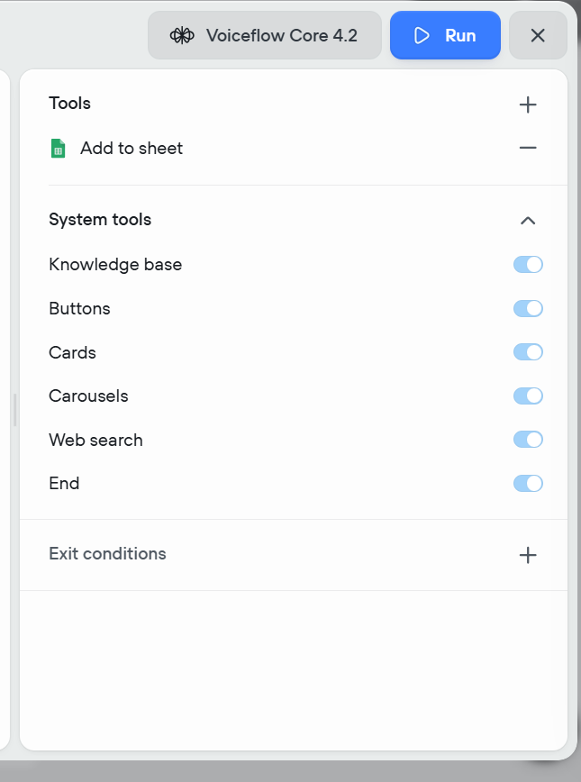
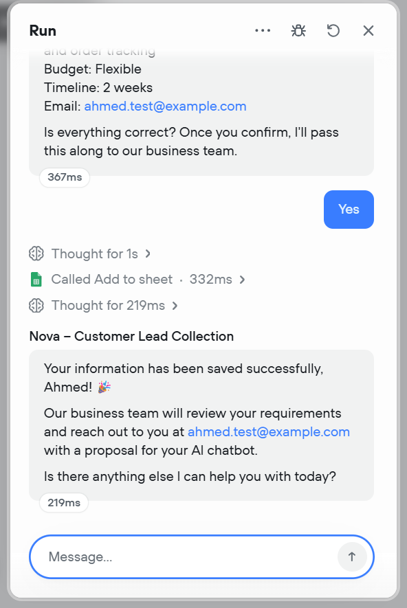
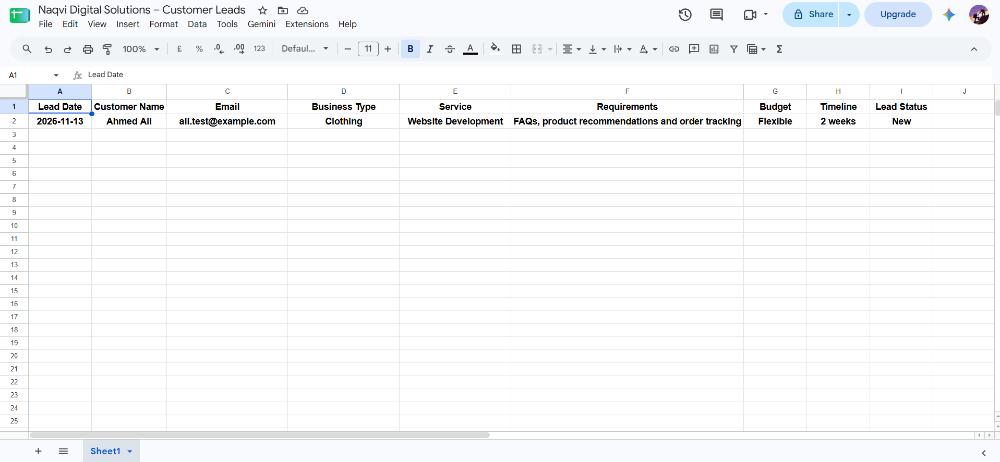

# Nova – AI Lead Collection Agent

A learning project: an AI agent built on Voiceflow that chats with potential
customers, collects lead details, and saves them to Google Sheets automatically.

> Demo project for a fictional company (Naqvi Digital Solutions). No real client data.

## Features
- Conversational lead collection: name, business type, service, requirements, budget, timeline, email
- Asks one question at a time and never repeats questions
- Detects incomplete email addresses and asks again
- Auto date stamping using Voiceflow's built-in `{vf_date}` variable (YYYY-MM-DD)
- Confirms details with the customer before saving
- Tool integration: writes one structured row to Google Sheets (`Sheet1!A:I`)
- Never claims data is saved unless the tool succeeds
- Handles English and Roman Urdu input

## Tech Stack
Voiceflow (Agent / Playbook), LLM, Google Sheets integration

## How It Works
```
User -> Nova (LLM Playbook) -> Confirm details -> "Add to sheet" tool -> Google Sheet
```

## Sheet Columns
Lead Date | Customer Name | Email | Business Type | Service | Requirements | Budget | Timeline | Lead Status

## Test Cases
| Test | Result |
|---|---|
| Full lead flow saved to sheet with correct date | Passed |
| Incomplete email (`ali@gmail`) | Bot asked for confirmation |
| Multiple fields in a single message | Handled correctly |

## Screenshots




## Prompt
Full instructions: [prompts/playbook-instructions.md](prompts/playbook-instructions.md)

## Future Improvements
- Knowledge base for FAQs
- Duplicate lead detection
- Email/WhatsApp notification on new lead
- Website widget deployment
- Python version using Groq/OpenAI API
